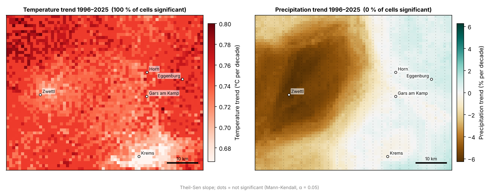
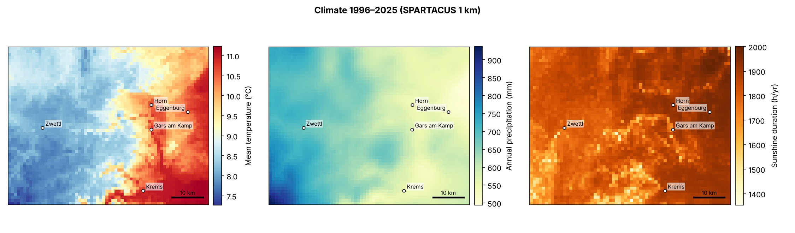
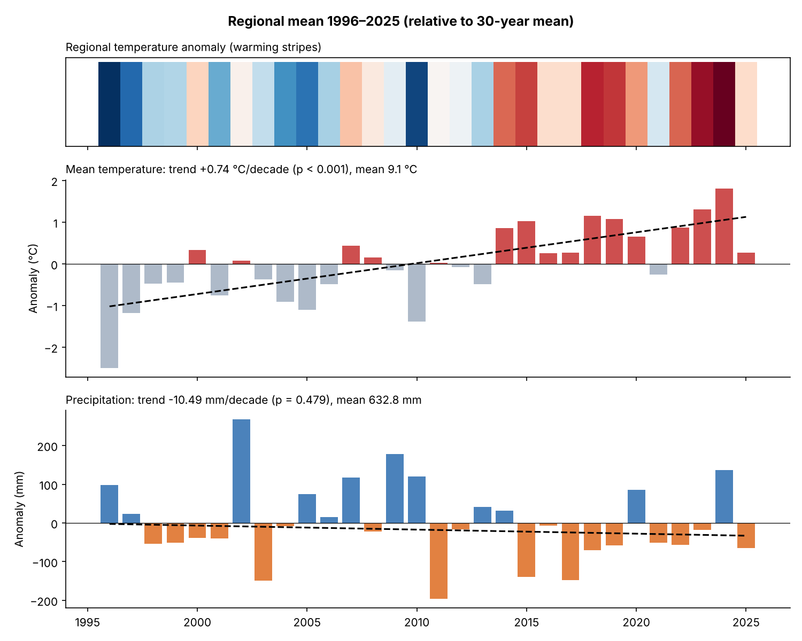
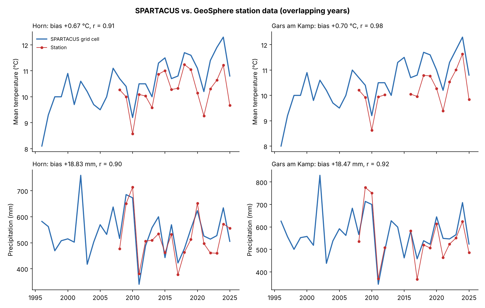
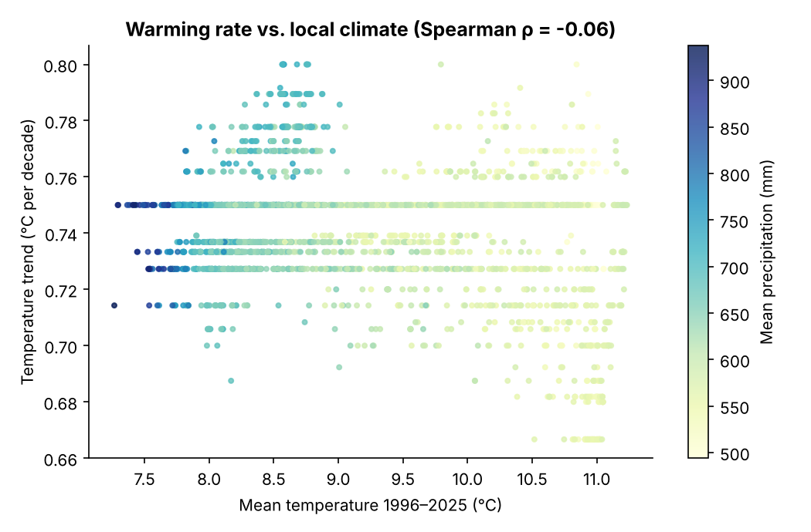

# Gridded Climate of the Eastern Waldviertel (SPARTACUS 1 km), 1996–2025

Raster analysis of 30 years of gridded climate data for a 66 × 52 km area between
Zwettl, Horn and Krems (Lower Austria), based on the GeoSphere Austria dataset
**SPARTACUS** (1 km resolution). The project maps the regional climate, calculates
temperature and precipitation trends for every grid cell, and compares the grid with
station measurements from Horn and Gars am Kamp.

It builds on the station-based climate analysis of Horn and Gars am Kamp (repository
`horn-gars-climate-analysis`).



## Study area and data

| | |
|---|---|
| Area | 15.02–15.90 °E, 48.38–48.83 °N (Waldviertel plateau, Horn basin, Kamp valley, Wachau edge) |
| Grid | 3,432 cells, 1 km × 1 km, ETRS89 / Austria Lambert (EPSG:3416) |
| Period | 1996–2025 (30 complete years; 2026 in the download is incomplete and excluded) |
| Variables | yearly mean temperature (TM), precipitation (RR), sunshine duration (SA) |

## Key results

| | Regional mean | Range across grid cells | Trend per decade |
|---|---|---|---|
| Mean temperature | 9.1 °C | 7.3–11.2 °C | **+0.74 °C** (p < 0.001) |
| Precipitation | 633 mm | 494–937 mm | −10 mm (−1.7 %, n.s.) |
| Sunshine duration | 1,833 h | 1,353–2,001 h | +44 h (p = 0.10) |

- **Strong climatic gradient over a short distance:** the Waldviertel plateau around Zwettl
  is about 4 °C cooler and receives nearly twice as much precipitation as the Horn basin
  and the Wachau edge near Krems. The eastern part lies in the rain shadow of the
  plateau (< 550 mm per year).
- **Significant warming everywhere:** temperature increased in **100 % of grid cells**
  (Mann-Kendall, p < 0.05), by 0.67–0.80 °C per decade. The decade 2016–2025 was
  **1.5 °C warmer** than 1996–2005. The four warmest years were 2024 (10.9 °C), 2023,
  2018 and 2019. Excluding the cold start year 1996 changes the trend only slightly
  (+0.68 °C per decade).
- **Warming is spatially uniform:** the warming rate is almost unrelated to the local mean
  temperature (Spearman ρ = −0.06). The cool plateau warms marginally faster than the
  Danube valley near Krems, but the differences are small.
- **No precipitation trend:** no grid cell shows a significant change. The weak drying
  signal on the western plateau (up to −6 % per decade) is within natural variability.
  Annual totals ranged from 437 mm (2011) to 900 mm (2002, the year of the August flood).
- **Grid vs. stations:** SPARTACUS reproduces year-to-year variability at Horn and Gars am Kamp
  well (r = 0.91–0.98 for temperature, 0.90–0.92 for precipitation). The grid is about
  0.7 °C warmer than both stations, which is consistent with the cold-air pools found in the
  station data. Other reasons may be different definitions of the daily mean and the
  approximate station positions used to select the grid cell.



| Regional time series | Station comparison |
|---|---|
|  |  |



## Methods

- **Data preparation** (`scripts/prepare_data.py`): the GeoJSON point features from the Data Hub
  are projected to EPSG:3416, snapped to the 1 km grid and stored as a NetCDF data cube
  (time × y × x) with `xarray`. Sunshine duration is converted from seconds to hours.
- **Climatology:** 30-year means per grid cell.
- **Trends:** Theil-Sen slope and Mann-Kendall test for each of the 3,432 grid cells and for the
  regional mean. Precipitation trends are given in % of the cell mean.
- **Warming vs. local climate:** Spearman correlation between the mean temperature and the
  temperature trend of all cells.
- **Validation:** nearest grid cell to Horn and Gars am Kamp (approximate town-centre coordinates)
  compared with annual GeoSphere station data (`data/external/`), using bias and Pearson correlation.

**Limitations:** yearly data allow no seasonal analysis. 30 years is a short period for
precipitation trends. SPARTACUS is an interpolated product and smooths small-scale features
such as cold-air pools in valleys. Station positions are approximate.

## Data

| File | Content |
|---|---|
| `data/raw/spartacus-v2-1y-1km_waldviertel_1996-2026.json` | Original download (GeoJSON, 3 variables, 1996–2026) |
| `data/processed/spartacus_yearly_waldviertel.nc` | NetCDF data cube (created by `prepare_data.py`) |
| `data/processed/climatology_and_trends.nc` | Mean, trend and p-value rasters |
| `data/processed/regional_annual_means.csv`, `summary.csv`, `station_validation.csv` | Result tables |
| `data/external/geosphere_stations_annual_horn_gars.csv` | Annual station values from `horn-gars-climate-analysis` |

The NetCDF files open directly in QGIS or Panoply.

**Sources:**
- GeoSphere Austria: SPARTACUS v2 – Spatial Dataset for Climate in Austria, yearly, 1 km.
  GeoSphere Austria Data Hub, licensed under CC BY 4.0. Downloaded on 22 November 2026.
- GeoSphere Austria: Stationsdaten-v2 (1 d), https://doi.org/10.60669/gs6w-jd70, CC BY 4.0.

## Usage

```bash
pip install -r requirements.txt
python scripts/prepare_data.py   # GeoJSON -> NetCDF cube
python scripts/analysis.py       # maps, trends, validation
```

## License

Code: MIT. Data: CC BY 4.0, GeoSphere Austria.
